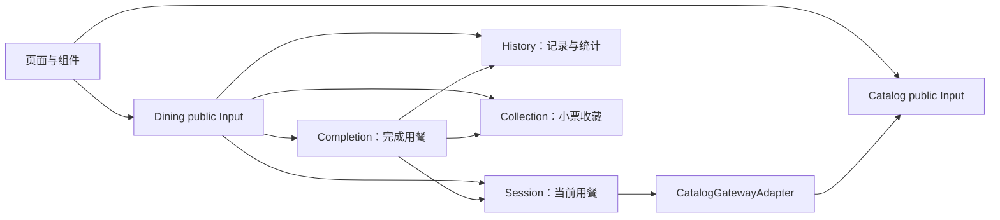

# 业务边界与依赖

客户端采用模块化单体。Catalog 和 Dining 为两个限界上下文，Session、History、Collection、Completion、Room 为 Dining 内部业务模块。Room 通过 WebSocket 连接独立 Node.js 服务端，房间状态由服务端维护。

## 边界判断

Catalog 管理种类、餐厅、每店分类与商品，以及本地自定义菜单。Dining 开始时通过公开查询固定菜单快照，按餐厅维护草稿，不读取 Catalog 内部类型或静态数据源。旧版等级查询仅用于兼容旧目录；新餐厅菜单不使用等级筛选。

当前用餐、已完成记录和收藏共享用餐业务语言。记录与收藏具有不同的删除生命周期，但现有规则主要是快照保存、去重和删除，没有形成额外上下文所需的独立业务模型。因此它们作为内部模块保持数据与实现封装；完成用餐是同一上下文的应用流程。

| 模块 | 数据与规则 | 入口 |
| --- | --- | --- |
| Catalog | 种类、餐厅、独立分类、商品、目录编辑与校验 | GetMenuInput、GetCatalogInput、EditCatalogInput |
| Session | 当前会话、待选、轮次、预览、会话状态校验 | 开始、加载、选菜、提交，以及内部准备结果与关闭 Input |
| History | 记录快照、按 ID 保存/删除、累计统计 | 加载、删除，以及内部保存 Input |
| Collection | 收藏快照、按 ID 收藏/删除 | 加载、删除，以及内部收藏 Input |
| Completion | 准备、保存、可选收藏、关闭的事务协调 | CompleteDiningInput |
| Room | 共享房间操作、连接恢复、请求确认及快照展示 | RoomInput |

多人结束结果通过 Completion 的 SaveRoomResultInput 幂等导入本地历史，并独立选择是否收藏，不关闭或覆盖单人会话。创建／加入成功后的单人覆盖由明确确认后的 DiscardSessionInput 执行。单人与多人展示使用独立 Store，房间详情及部署见 [多人模式](multiplayer.md)。

## 公开 API 和装配

- 页面只从 `contexts/catalog/public.ts`、`contexts/dining/public.ts` 引用 Input。
- 模块 public.ts 公开自身 Input；Completion 通过这些入口协作，不访问其他模块模型或 Repository。
- Dining 的上下文入口不向页面导出 PrepareDiningCompletion、CloseDining、SaveRecord、CollectReceipt 等内部操作。
- 模块 Configuration 创建具体实现，不依赖 Vue、Pinia 或全局注册表。DiningConfiguration 连接模块，全局 registerApplication 注入 Store、平台、导航并注册公开 Input。
- 领域和应用只依赖自己的模型、端口和纯工具；基础设施实现端口。

新增独立模块或上下文前，应先明确其业务语言、规则、数据所有权和变化原因，不以页面、Store 或物理表的数量判断边界。
